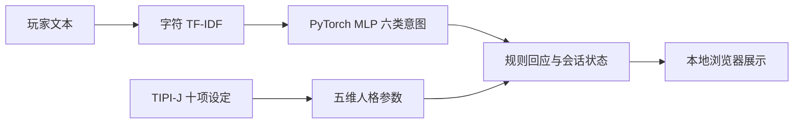
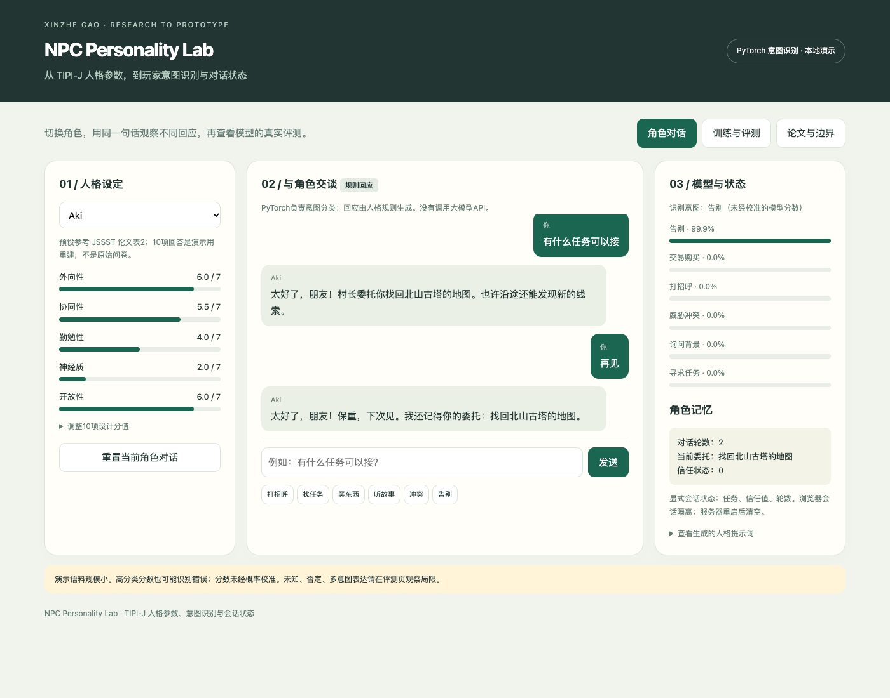

# NPC Personality Lab

一个结合 TIPI-J 人格参数、PyTorch 玩家意图识别与显式会话状态的 NPC 交互原型，支持本地运行与训练评测结果查看。

**作者：高信哲 / Xinzhe Gao**

仓库包含源码、界面截图、已训练的小模型和评测报告。当前演示在本地浏览器运行，尚未部署在线试玩。

## 当前能演示什么

| 模块 | 已实现内容 |
| --- | --- |
| 玩家意图识别 | 字符 unigram/bigram TF-IDF 特征与 PyTorch MLP，识别问候、任务、交易、背景、冲突和告别六类意图 |
| 人格参数 | TIPI-J 十项分值的反向计分、五维计算和归一化，支持五名角色预设与参数调整 |
| 角色交互 | 根据意图、人格参数和当前状态，用显式规则生成 NPC 回应 |
| 会话状态 | 维护任务、信任值和轮次，支持角色状态重置与浏览器会话隔离 |
| 训练与评测 | 数据划分、训练、验证选模、模型保存加载，以及准确率、Macro-F1、混淆矩阵和逐条案例 |
| 结果检查 | 展示未校准的模型分数，并检查否定、多意图及域外输入中的误判 |

### 交互流程



<details>
<summary>查看现有交互界面截图</summary>



</details>

## 快速运行

本地已验证环境为 **macOS ARM64、Python 3.12、CPU**。依赖版本记录在 [requirements.txt](requirements.txt)，其他系统尚未验证。

```bash
git clone https://github.com/XinzheGao/npc-personality-lab.git
cd npc-personality-lab
python3 -m venv .venv
.venv/bin/python -m pip install -r requirements.txt
.venv/bin/python verify.py
.venv/bin/python app.py
```

浏览器打开 **http://127.0.0.1:8765**。仓库附带 `artifacts/intent.pt`，首次启动无需重新训练，也不需要 API Key。

若 8765 端口已被占用，可指定其他端口：

```bash
.venv/bin/python app.py --port 8876
```

然后访问 **http://127.0.0.1:8876**。macOS 也可使用仓库中的 `start.command` 启动。

### 建议尝试

1. 保持输入相同，切换 Aki、Rina 等角色，观察规则回应的差异。
2. 输入“有什么任务可以接”，再输入“再见”，查看任务如何影响后续回应。
3. 调整十项人格分值，检查五维分数与生成的人格提示词。
4. 重置当前角色，观察会话状态清空后的回应。
5. 查看“训练与评测”，检查固定测试案例及否定、域外输入的误判。

## 训练与评测

```bash
.venv/bin/python train.py
.venv/bin/python verify.py
```

训练流程采用固定随机种子 42，词表与 IDF 只由训练集生成。模型为 48 维隐藏层的 MLP，使用 ReLU、Dropout、交叉熵和 AdamW；训练 80 轮，按验证损失选择 checkpoint，再评估固定测试集。

| 划分 | 样本数 |
| --- | ---: |
| 训练 | 72 |
| 验证 | 18 |
| 测试 | 24 |

当前小规模自建演示集的记录为 **24/24 分类正确，Accuracy 1.0，Macro-F1 1.0**。完整训练曲线、混淆矩阵和逐条预测见 [artifacts/report.json](artifacts/report.json)。语料为小规模自建演示集，可在 [data.py](data.py) 中逐条查看。

不同集合之间没有完全相同的句子，但存在相近词汇与表达。上述分数仅说明当前演示集的分类情况，不能外推为真实游戏中的泛化效果。报告同时保留了域外与否定表达的高分误分类，例如“今天天气如何”被识别为告别。

修改数据或模型时，应保留验证集用于选模；若根据测试结果继续调整，应新增未参与开发的测试样本。

## 与已有 NPC 研究的关系

作者已有两阶段 TIPI-J / LLM 游戏 NPC 研究：

- **IPSJ 第88届全国大会（2026）**：使用 DeepSeek-V3 研究多轮人格保持与漂移，500个 NPC—场景样本中385个保持成功，成功率为77%。[官方大会目录，5V-03](https://www.ipsj.or.jp/event/taikai/88/WEB/html/program/program4.html)
- **JSSST 第43届大会（2026）**：在另一场景及判定标准下比较 DeepSeek、Gemini、Claude，论文报告的人格一致率分别为81%、86%、89%。[官方大会程序，7a-1-R](https://jssst2026.wordpress.com/program/)

研究中使用 TIPI-J 参数构建大模型人格提示词，并对生成的多轮对话进行人工评判。**本仓库新增的是 PyTorch 意图分类、规则交互、显式会话状态和本地评测界面**；论文实验没有使用这里的小型 MLP，也未在本仓库重跑。两篇论文的场景与判定标准不同，77%与89%不构成连续提升。

详细方法与研究结果的范围见 [研究说明](docs/research.md)。

## 当前范围与后续工作

当前原型尚未调用 LLM API，NPC 回应由规则模板生成。页面中的人格提示词用于展示，尚未发送给大模型。会话状态只保存在进程内存中，服务重启后清空。

这个项目展示了 NPC 交互与模型评测的基础流程；游戏引擎接入、自动游玩以及观测／动作／奖励接口尚未实现。未实现大模型微调、后训练、强化学习、多模态或自动人格一致性评分。

后续计划：

- 接入真实 LLM，记录模型原始回复、调用耗时及用量。
- 在相同场景与输入条件下，比较无目标人格、普通文字人设与 TIPI-J 参数化人设。
- 引入由游戏事件确认的局内记忆与任务结果。
- 扩展交互日志、重复实验和回放，逐步建立可观察、可比较的 NPC 评测流程。

这些是开发方向，尚不属于当前已完成能力。

## 代码结构

```text
app.py                  本地 HTTP 服务、会话隔离和输入校验
index.html              人格配置、对话、训练评测与研究说明界面
data.py                 六类自建演示语料与额外探针
model.py                字符特征、TF-IDF、小型 MLP 和模型加载
train.py                训练、验证选模及评测报告生成
npc.py                  TIPI-J 计分、角色预设、规则回应与状态更新
verify.py               参数计分、模型加载及交互状态检查
artifacts/intent.pt     已训练的演示模型
artifacts/report.json   当前训练评测结果与失败案例
docs/research.md        两阶段研究与本原型的对应关系
docs/images/npc-demo.png 界面截图
```

## 资料来源

训练流程参考 [PyTorch 官方优化教程](https://docs.pytorch.org/tutorials/beginner/basics/optimization_tutorial.html)。
