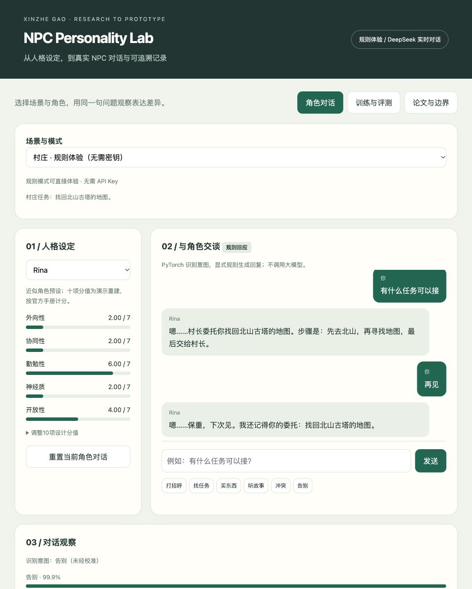
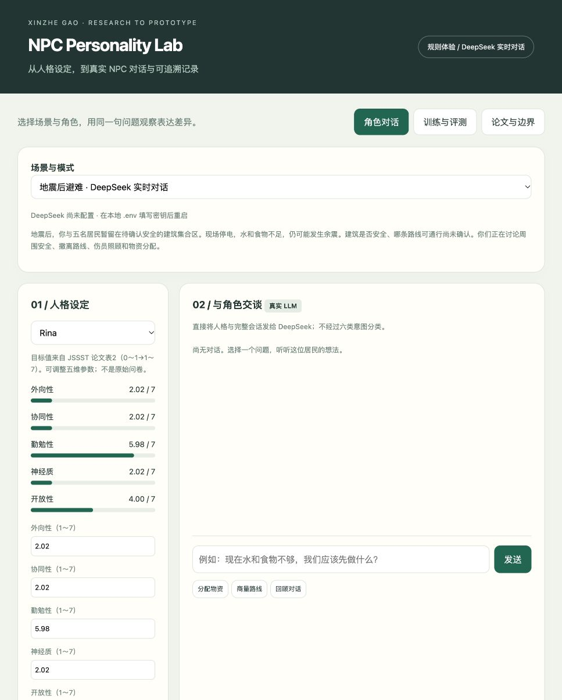
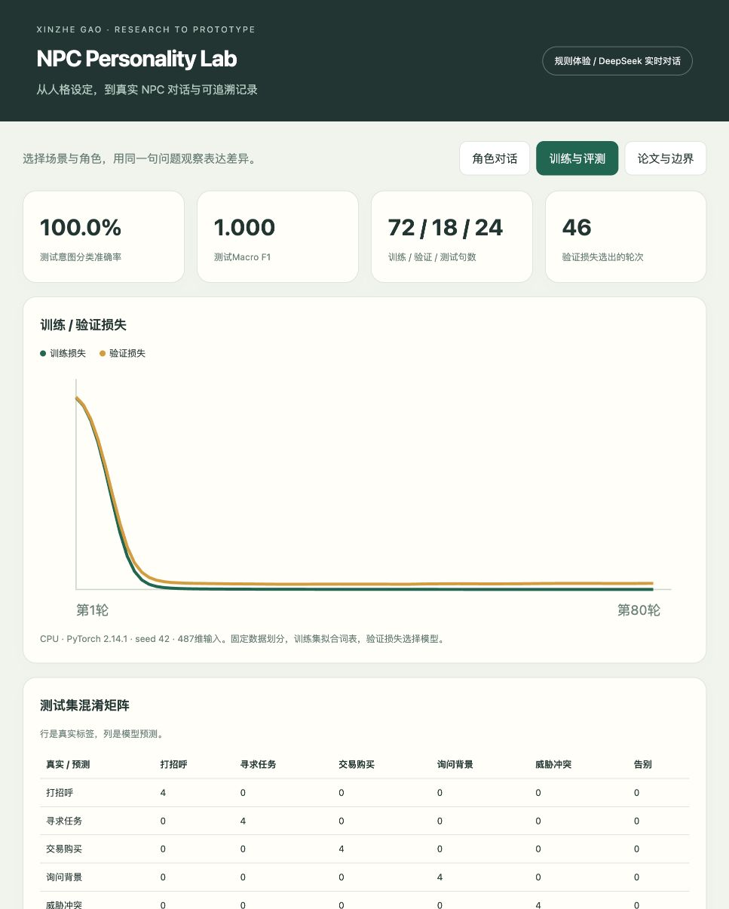
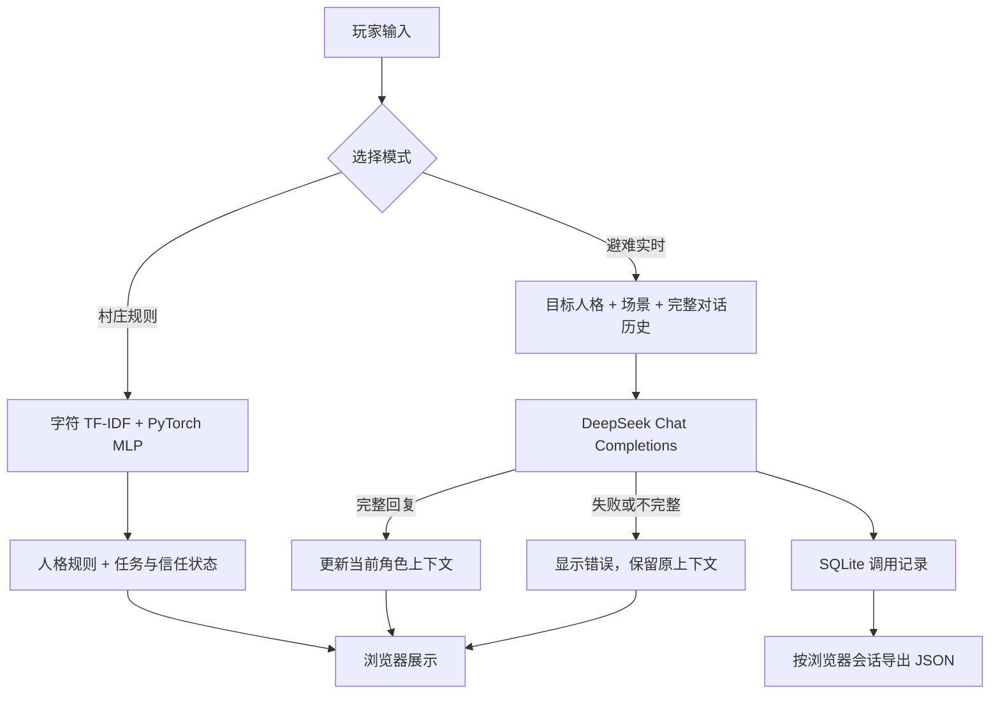

# NPC Personality Lab

**把 TIPI-J 人格设定、多轮 NPC 对话与实验记录放进一个可交互的本地原型。**

本项目承接两篇游戏 NPC 人格对话研究：一方面提供无需密钥的 PyTorch 意图识别与规则互动，另一方面提供基于论文目标人格配置的 DeepSeek 对话接口，让人格参数、输入、回复和调用记录都可以查看。

**Python · PyTorch · TIPI-J / Big Five · DeepSeek · SQLite · 原生 Web 界面**

[快速运行](#快速运行) · [功能截图](#功能截图) · [两篇论文与本项目](#两篇论文与本项目) · [验证与局限](#验证与局限)

> 当前为本地浏览器 demo，尚无在线试玩。规则模式已运行验证；DeepSeek 接口已通过模拟响应与本地 HTTP 流程检查，真实账户联调尚未完成。

## 功能截图

截图来自实际运行界面。规则模式中的回复由显式规则生成；避难场景截图展示的是接口与人格配置，尚无真实模型回复。

### 1. 角色对话：同一句话，不同的回应

选择 Aki、Mika、Yui、Rina 或 Kana，查看五维人格并调整演示分值。玩家输入经字符 TF-IDF 与 PyTorch MLP 识别为六类意图，再结合人格规则和当前状态生成回复。

下图中，Rina 在接受委托时给出步骤；玩家告别后，角色仍提到刚才的委托。切换角色可以重复同一输入，观察规则设计带来的差异。



任务、信任值与轮次可以查看和重置。它们是显式会话状态，不表示已经实现游戏中的移动、交易或任务完成。

### 2. 避难场景：论文目标人格与 DeepSeek 接口

场景改编自第二篇论文的地震后避难讨论。五名 NPC 的目标人格取自论文表2的公布值，保留原始0～1值，再用 `1 + 6x` 换算到1～7供模型使用；也可以直接调整五维目标。

实时模式将人格、场景与当前角色的完整对话历史发送到 DeepSeek，不经过六类意图分类。界面支持查看提示词、模型、耗时和本轮调用记录，并导出当前浏览器会话的记录。

<details>
<summary>查看避难场景配置截图（尚未配置密钥）</summary>



</details>

未配置密钥、请求失败或输出不完整时，页面显示错误，本轮不进入对话历史。失败不会自动替换成规则回复。

### 3. 训练与评测：展示结果，也保留失败案例

页面展示训练／验证损失、固定测试集的准确率与 Macro-F1、混淆矩阵、逐条预测，以及域外、否定和多意图输入的探针结果。

<details>
<summary>查看训练评测截图</summary>



</details>

附带报告中的固定测试集为24句，记录为24/24分类正确、Macro-F1为1.0。语料规模很小，集合之间存在相近词汇，不能外推为真实游戏中的泛化效果。例如“我不想打你”被强制分类为威胁冲突，“今天天气如何”被分类为告别；高分也可能判断错误。完整记录见 [artifacts/report.json](artifacts/report.json)。

## 快速运行

已验证环境：**macOS ARM64、Python 3.13、CPU**。依赖见 [requirements.txt](requirements.txt)，其他系统尚未验证。

```bash
git clone https://github.com/XinzheGao/npc-personality-lab.git
cd npc-personality-lab
python3.13 -m venv .venv
source .venv/bin/activate
python -m pip install -r requirements.txt
python verify.py
python app.py
```

浏览器打开 [http://127.0.0.1:8765](http://127.0.0.1:8765)。仓库附带训练好的 `artifacts/intent.pt`，规则模式无需重新训练或配置 API Key。macOS 也可使用 [start.command](start.command) 启动。

端口冲突时运行 `python app.py --port 8876`，然后访问对应端口。

### 三分钟体验

1. 保持“村庄 · 规则体验”，选择 Aki，点击“找任务”，再点击“告别”。
2. 切换 Rina，重复相同操作，比较表达和任务步骤。
3. 调整十项设计分值，查看五维参数变化；重置当前角色后重新开始。
4. 打开“训练与评测”，查看固定测试结果和域外误判。
5. 切换“地震后避难”，查看第二篇论文的目标人格配置。

### 配置 DeepSeek

首次使用实时模式时，复制模板：

```bash
cp .env.example .env
```

在本地 `.env` 中填写 `DEEPSEEK_API_KEY`，确认 `DEEPSEEK_MODEL`，再重启服务。模板还提供温度、输出上限与超时配置；已有环境变量优先于文件。文件仅支持简单 `KEY=value`，不执行 shell 或变量展开。

选择“地震后避难 · DeepSeek 实时对话”，向 Aki 与 Rina 分别输入：

> 现在水和食物不够，我们应该先做什么？

两个角色使用独立上下文。查看实际回复后，可展开提示词与完整调用记录，再点击“导出本浏览器实时调用记录”。当前模型配置不代表论文使用的历史模型版本，API 协议参考 [DeepSeek 官方文档](https://api-docs.deepseek.com/api/create-chat-completion/)。

密钥由服务端读取，不发送到浏览器，也不作为配置字段写入调用记录。`.env` 与 `runtime/` 已被 Git 忽略。请勿把密钥粘贴到对话输入中。

## 系统流程



### 上下文与记录

| 内容 | 当前行为 |
| --- | --- |
| 上下文隔离 | 浏览器会话、角色、规则／实时模式、人格配置相互独立 |
| 实时轮数 | 每个配置最多15轮，保留完整历史；达到上限后需重置 |
| 刷新与重启 | 刷新恢复当前配置的进程内上下文；服务器重启后上下文清空 |
| 调用落盘 | 实时请求保存至 `runtime/calls.sqlite3`，包括失败请求；规则模式不写入此记录 |
| 重置 | 清除当前模式下该角色的上下文，保留历史调用记录 |
| 导出 | 当前浏览器会话的 JSON；cookie 丢失后不能从界面找回旧会话记录 |

调用记录包含 UTC 时间、会话／对话／请求 ID、角色、场景、目标人格、提示词版本、请求模型、生成设置、实际请求消息、原始响应、耗时与状态。数据库在重启后仍保留；导出内容包含玩家文本，公开分享前需筛选。

## 两篇论文与本项目

| 研究 | 问题与实验 | 与 demo 的连接 |
| --- | --- | --- |
| **IPSJ 第88届全国大会，2026，5V-03** | 五名 NPC 在恋爱话题下进行多轮对话，观察人格保持及中后期同质化 | 提供人格保持与漂移的研究问题；该场景尚未接入当前 demo |
| **JSSST 第43届大会，2026，7a-1-R** | 在地震后避难讨论中比较 DeepSeek、Gemini 与 Claude 的人格表达 | 提供避难情境与表2目标人格；当前玩家—NPC中文对话是新增改编 |

- 《ゲームNPC対話生成のためのTIPIを用いたパーソナリティモデルの基礎検討》：[IPSJ 官方大会目录](https://www.ipsj.or.jp/event/taikai/88/WEB/html/program/program4.html)。
- 《TIPI-Jに基づく大規模言語モデルを用いたゲームNPC人格対話生成に関する研究》：[JSSST 官方大会程序](https://jssst2026.wordpress.com/program/)。

论文研究使用 LLM 生成对话并人工评价；本仓库的 PyTorch 小型意图分类器为后续原型新增模块。当前仓库没有重跑论文实验，也没有实现原论文中的多 NPC 群聊。

第一篇报告385/500个 NPC—场景样本保持成功，比例为77%；第二篇采用不同场景与判定标准，结果不能与第一篇拼接成性能提升曲线。第二篇的 Gemini 汇总值在不同文档版本中存在85%／86%差异，待原始统计核对。详细方法、结果范围与版本说明见 [研究说明](docs/research.md)。

相关实验框架：[llm-npc-dialogue-system](https://github.com/XinzheGao/llm-npc-dialogue-system)。

### 人格参数与计分

- 规则模式使用近似角色预设和演示重建的十项分值，不将其作为原始问卷。
- 实时模式直接使用论文公布的五维目标，来源与场景说明见 [configs/jssst2026.json](configs/jssst2026.json)。五维分数不能唯一恢复原始十项回答。
- 新版本按 [TIPI-J 官方手册](https://jspp.gr.jp/doc/manual_TIPI-J.pdf) 修正神经质计分为 `(Q4 + 8 - Q9) / 2`，同步修正前端与演示分值重建。历史论文结果和公布的目标值未被重算，修正对原实验的影响尚未确认。
- 人格维度到对话／行为倾向的映射是本 demo 的设计，尚未证明优于普通文字人设，也不是经心理学验证的行为预测器。

## 验证与局限

```bash
python verify.py
python -m unittest discover -s tests -v
```

| 检查 | 当前证据 |
| --- | --- |
| 原型验证 | 人格计分与输入校验、模型加载、规则角色差异、任务状态、重置、未知输入通过 |
| 新增自动检查 | 7项通过，覆盖模拟接口协议、失败处理、记录保存及本地 HTTP 隔离／重置／导出流程 |
| 页面操作 | 规则对话与任务记忆、避难人格配置、缺少密钥时明确显示错误已检查 |
| 真实 DeepSeek | 尚未完成账户联调；模拟测试不代表真实模型生成效果 |
| 人格表现 | 尚无新 demo 的人格保持率、玩家实验或模型排名 |

目前仅支持本地使用，没有公开服务认证。实时模式生成文本与建议，不执行游戏动作，也不更新规则模式的任务或信任状态。尚未实现游戏引擎接入、多人 NPC 自主协作、长期记忆、自动人格评分、LLM 微调或强化学习。

详细记录见 [验证说明](docs/verification.md)。

### 重新训练意图模型

```bash
python train.py
python verify.py
```

当前训练／验证／测试划分为72／18／24，随机种子为42。词表和 IDF 只由训练集生成；48维隐藏层 MLP 使用 ReLU、Dropout、交叉熵与 AdamW，训练80轮，按验证损失选择 checkpoint。数据见 [data.py](data.py)，训练流程见 [train.py](train.py)。参考 [PyTorch 官方优化教程](https://docs.pytorch.org/tutorials/beginner/basics/optimization_tutorial.html)。

## 项目结构

```text
app.py                    本地 HTTP 服务、模式切换与上下文隔离
dialogue.py               DeepSeek 接口、场景提示词与 SQLite 调用记录
npc.py                    TIPI-J 计分、规则预设、回应与状态更新
index.html                对话、人格配置、训练评测和研究说明界面
model.py / data.py         意图模型、字符特征和自建演示语料
train.py / verify.py       训练评测与原型验证
configs/jssst2026.json     论文目标人格与场景来源
.env.example              无密钥环境变量模板
tests/test_dialogue.py    模拟接口与本地 HTTP 流程检查
artifacts/                已训练模型与固定评测报告
docs/                     研究说明、验证记录与实际截图
runtime/                  本地调用数据库，不上传 Git
```

## 后续方向

- 完成真实 DeepSeek 联调，整理带完整配置的对话样例。
- 加入多 NPC 群聊与逐轮回放，观察表达随上下文变化的过程。
- 在固定模型、场景与输入条件下，比较普通文字人设和 TIPI-J 参数化人设。
- 将对话建议接入由游戏规则验证的动作与任务结果。

作者：[Xinzhe Gao / 高信哲](https://github.com/XinzheGao)。
